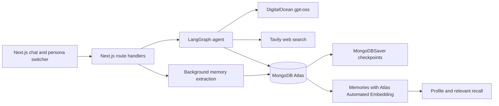

# Claudius Minor

Claudius Minor is a small chat agent with an open-weight model, durable conversations, web search, and long-term personal memory. MongoDB Atlas stores the whole backend, including agent checkpoints and memories. Atlas Automated Embedding powers semantic memory search with Voyage `voyage-4` without adding embedding code or an embedding SDK to the app.

The core idea is this: MongoDB as your agent's entire backend, from vector store to memory management system.

## Architecture

## Prerequisites

- Node.js 22 or newer and pnpm
- A free MongoDB Atlas M0 cluster with an Atlas Vector Search index capability
- A DigitalOcean model access key for Serverless Inference
- A free Tavily API key

## Run locally

1. Install packages with `pnpm install`.
2. Copy `.env.example` to `.env`, add credentials, run `pnpm spike:do-model-list`, then set `CHAT_MODEL` and `EXTRACTION_MODEL` to the exact IDs returned by the endpoint.
3. Allow Atlas network access from your development machine.
4. Create collections, indexes, vector index, and personas with `pnpm db:setup`.
5. Start the app with `pnpm dev` and open `http://localhost:3000`.

Use the persona switcher to choose Angela, Betty, or Caroline. The cookie is an instructional user switcher, not authentication.

## Deploy

DigitalOcean App Platform accepts the spec in `.do/app.yaml` or the Deploy to DigitalOcean template in `.do/deploy.template.yaml`. Add the environment values as app secrets. Atlas network access must allow `0.0.0.0/0` for App Platform. That broad access is a deployment limitation, not recommended for a production release.

## Presenter access

Set `APP_ACCESS_CODE` as a runtime **SECRET** on the `web` service before deploying. Generate a high-entropy code with `openssl rand -hex 24`. Production rejects all API requests when the code is missing or shorter than 16 characters. Local development permits access without a configured code.

Enter the code on the homepage to open the demo. The browser keeps it only in React memory and sends it in the `x-access-code` header on every API request, including streaming chat. It never stores the code in a cookie, URL, local storage, or session storage. Reloading the page or clicking **Lock demo** requires entering it again. The existing persona cookie still selects Angela, Betty, or Caroline; it does not grant API access.

Use **Reset persona** to delete every conversation, checkpoint transcript, and memory for the selected persona. Type `RESET` in the confirmation dialog. Other personas stay untouched; reset each one separately for a clean demo. The server rejects reset while another chat, extraction, reset, or memory deletion runs. Extraction finishes inside the chat stream before the server releases its shared lock. The reset is irreversible.

Keep the code private and enter it off-screen before presenting. Anyone who knows it can use the shared personas and consume inference and search credits. The backend limits the shared demo to one active mutation, 10 accepted chat attempts per minute, and 200 per UTC day. MongoDB stores the lock and counters across instances and restarts. These request limits are not a monetary spending cap. Rotate the deployment secret and redeploy if it leaks. In-flight requests can still finish after locking or rotating the code.

### Demo safeguards

Set `DEMO_CHAT_ENABLED=false` on the deployment and redeploy to stop new chat requests. Reset and reads remain available. Stop the app entirely for an immediate emergency shutdown. Configure provider quotas or spending controls separately where supported; billing alerts alone do not stop requests.

Each chat input allows 4,000 characters. Inference uses at most 24 recent messages and 24,000 serialized content characters, keeping complete turns rather than orphan tool results. Chat output allows 1,024 tokens per invocation, extraction 2,048, and relation comparison 1,024. Extraction allows at most five candidates per turn. Chat has a 120-second graph deadline and bounded inference retries and timeouts. Full transcripts remain in checkpoints.

The exclusive operation lock deliberately does not expire. A paused worker must not resume writing after another worker resets its data. If a process crashes while holding it, stop **every** app instance, then run `CONFIRM_DEMO_STOPPED=yes pnpm demo:unlock` using that deployment's MongoDB credentials before restarting. Never clear the lock while workers are running. Run `pnpm db:setup` to add the usage-counter TTL index; the lock and counters otherwise work without setup.

Run `pnpm verify:live` with `APP_URL`, `APP_ACCESS_CODE`, and the matching `MONGODB_URI` to check deployment memory extraction, vector indexing, fresh-conversation recall, and supersession lineage. It creates marked synthetic project memories and removes only its own conversations and memories afterward. It uses real inference credits and must run when no presenter chat is active.

For scripted API checks, include `x-access-code` in each request. Do not commit a populated code or use a `NEXT_PUBLIC_` variable.

## Livestream guide

See [LIVESTREAM-GUIDE.md](.assets/LIVESTREAM-GUIDE.md) for the detailed one-hour runbook, presenter script, setup and rehearsal steps, demo prompts, recovery plan, and tag preflight. Complete its service checks and rehearsal before presenting the repaired livestream tags.

The `livestream` branch follows `start`, `step-1`, `step-2`, `step-3`, `step-4`, and `final` for chat and search, durable checkpointing, memory writes, recall, and contradiction handling. The `final` file tree matches `main`.

## Known limitations

- Atlas Automated Embedding is asynchronous. A recently written memory may not appear in vector search immediately.
- Two similar memories extracted in the same batch cannot find one another through vector search before the index processes them.
- The cookie persona switcher demonstrates isolation but does not provide authentication.
- DigitalOcean App Platform needs Atlas network access `0.0.0.0/0` in this setup.
- Semantic similarity selects related memories; a structured model comparison decides whether facts duplicate, replace, or coexist. This adds inference cost to memory writes.

## Claudius article series

[Read the Claudius article series](ARTICLE_SERIES_URL)
