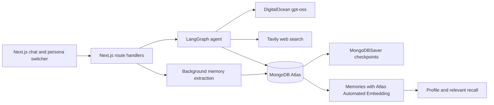

# Claudius Minor

Claudius Minor is a small chat agent with an open-weight model, durable conversations, web search, and long-term personal memory. MongoDB Atlas stores the whole backend, including agent checkpoints and memories. Atlas Automated Embedding powers semantic memory search with Voyage `voyage-4` without adding embedding code or an embedding SDK to the app.

The core idea is simple: MongoDB can be your agent's entire backend, from vector store to memory management system.

## Architecture

## Prerequisites

- Node.js 22 or newer and pnpm
- A free MongoDB Atlas M0 cluster with an Atlas Vector Search index capability
- A DigitalOcean model access key for Serverless Inference
- A free Tavily API key

## Run locally

1. Install packages with `pnpm install`.
2. Copy `.env.example` to `.env`, add credentials, and verify the model IDs with `pnpm spike:do-model-list`.
3. Allow Atlas network access from your development machine.
4. Create collections, indexes, vector index, and personas with `pnpm db:setup`.
5. Start the app with `pnpm dev` and open `http://localhost:3000`.

Use the persona switcher to choose Angela, Betty, or Caroline. The cookie is an instructional user switcher, not authentication.

## Deploy

DigitalOcean App Platform accepts the spec in `.do/app.yaml` or the Deploy to DigitalOcean template in `.do/deploy.template.yaml`. Add the environment values as app secrets. Atlas network access must allow `0.0.0.0/0` for App Platform. That broad access is a deployment limitation, not an ideal production security posture.

## Livestream tags

The `livestream` branch presents a linear path through `start`, `step-1`, `step-2`, `step-3`, `step-4`, and `final`. The prepared `start` state demonstrates chat and search, then the live steps add durable checkpointing, memory writes, recall, and contradiction handling.

## Known limitations

- Atlas Automated Embedding is asynchronous. A recently written memory may not appear in vector search immediately.
- Two similar memories extracted in the same batch cannot find one another through vector search before the index processes them.
- The cookie persona switcher demonstrates isolation but does not provide authentication.
- DigitalOcean App Platform needs Atlas network access `0.0.0.0/0` in this setup.
- The score thresholds require live calibration against the target Atlas cluster and model.

## Claudius article series

[Read the Claudius article series](ARTICLE_SERIES_URL)
